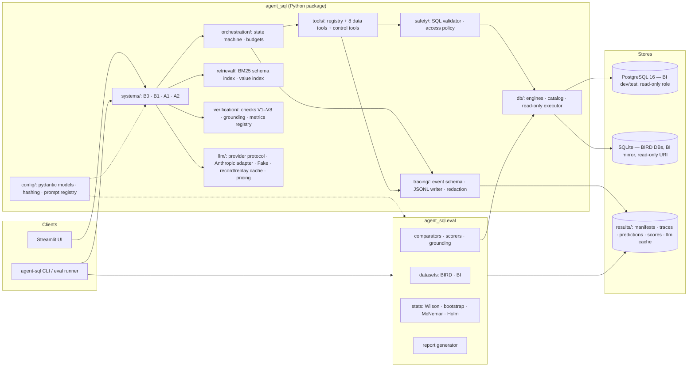
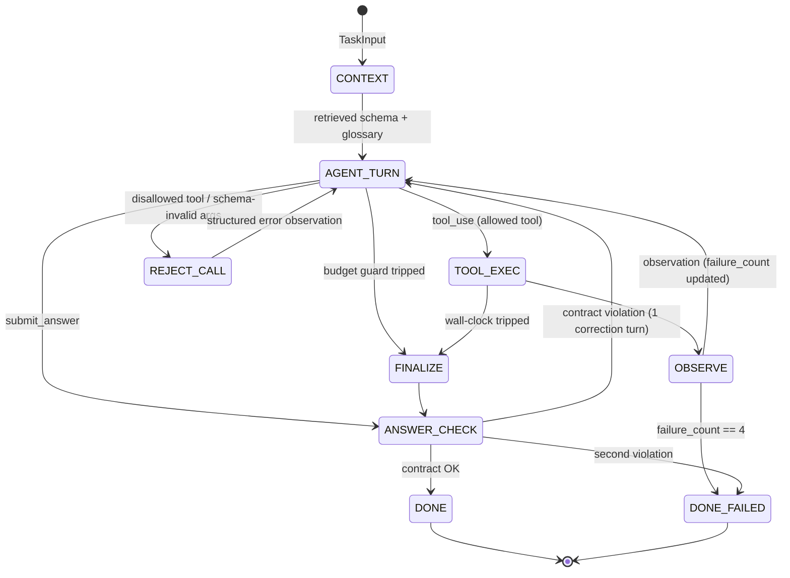
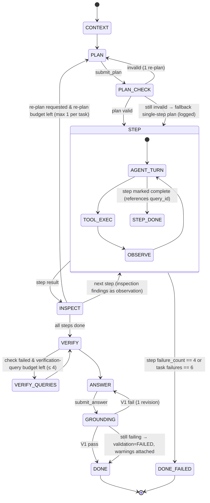
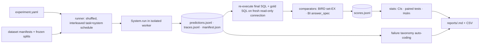

# Architecture — Agentic SQL Analyst

> **Status:** SPECIFIED (Phase 0). Spec version 0.1.0, 2026-11-23. No component exists yet. Diagrams describe intended structure.

## 1. Principles

1. **The LLM chooses analytical actions; deterministic code enforces everything else.** SQL safety, permissions, execution limits, budgets, termination, answer-contract checks, and result validation are plain Python with unit tests. Prompts guide behavior; they enforce nothing.
2. **No agent framework.** A small, explicit state machine ([§4](#4-orchestration-bounded-state-machines)) is easier to test, trace, and ablate than a general graph framework. Adding one later requires an ADR showing a concrete need.
3. **One owner per behavior.** One SQL validator, one executor, one budget tracker, one metric registry (`metrics.yaml`, which also produces the glossary text), one trace writer. The four systems compose these components; they do not re-implement them.
4. **Every architecture is independently runnable.** B0, B1, A1, and A2 share `System.run(TaskInput) -> RunResult`, so the harness, UI, and tests treat them uniformly.
5. **Evidence over narration.** Each run produces a manifest plus a JSONL trace. Reports are regenerated from raw outputs, never edited by hand.
6. **Fail closed.** Unparseable SQL, an unknown table, a budget overrun, a served-model mismatch, or a schema-invalid answer each leads to a defined terminal status, never a silent continuation.

## 2. Component view



### 2.1 Package layout (created in Phase 1, filled in by later phases)

```text
agent_sql/
  config/          settings models, config loading + canonical hashing, prompt registry
  llm/             base.py (LLMClient protocol), anthropic_client.py, fake.py, cache.py, pricing.py
  db/              engines.py, catalog.py (SQLAlchemy inspector), executor.py (timeouts, fetch limits)
  safety/          validator.py (sqlglot AST rules), policy.py (allowlists, restricted columns)
  tools/           registry.py (JSON schemas, permissions), schema_tools.py, sql_tools.py, result_tools.py
  retrieval/       schema_docs.py, bm25.py, value_index.py
  orchestration/   state_machine.py, budgets.py, termination.py
  verification/    metrics.yaml, metrics_registry.py, checks.py (V1–V8), grounding.py
  systems/         base.py, b0_oneshot.py, b1_retrieval.py, a1_agent.py, a2_planner.py, composer.py
  tracing/         events.py, writer.py, redact.py
  eval/            datasets/{bird.py,bi.py}, comparators.py, scoring.py, stats.py, runner.py,
                   failure_taxonomy.py, report.py, cli.py
  ui/              app.py, pages/{ask.py,compare.py,trace.py}, charts.py
bi_dataset/        schema.sql, generate.py, events/{dev.json,test.json}, tasks/{dev,val,test,study}.jsonl
configs/           models.yaml, pricing.yaml, systems/{b0,b1,a1,a2,...}.yaml, experiments/*.yaml
prompts/           <system>/<name>.v<N>.md   (versioned, hashed into the run manifest)
data/              manifests/*.json (tracked); downloads/ (gitignored)
tests/             unit/, integration/, safety_corpus/, replay/, ui/, spec/
results/           (gitignored) raw experiment outputs
reports/           (tracked) generated summary reports
```

## 3. Why a deterministic orchestrator rather than a framework

| Need | Deterministic orchestrator | General agent framework |
| --- | --- | --- |
| Hard budgets and termination | Explicit counters checked on every transition | Often per-node; must be retrofitted |
| Ablation by flag (drop planning, drop verification) | One config flag removes a state or tool | Graph surgery |
| Exact, replayable traces | We own the event schema | Framework-specific callbacks |
| Unit-testing transitions | Pure transition function | Harder to isolate |
| Dependency surface | `anthropic`, `sqlalchemy`, `sqlglot`, `pydantic` | Large, fast-moving |

The LLM loop uses the provider's native tool calling with `tool_choice: auto` and `strict: true` tool schemas. Forced tool choice is rejected by the pinned model ([§5](#5-llm-provider-abstraction)). The controller exposes, per state, only the tools that state allows, and rejects any other call with a structured error.

## 4. Orchestration: bounded state machines

### 4.1 Shared concepts

- **Candidate failure**: an `execute_readonly_sql` result with status ≠ `OK`, or a `validate_sql` result of `REJECTED`. Each one increments `failure_count` for the current scope (task for A1, step for A2).
- **Repair budget**: the initial attempt plus at most **3 repair attempts**. A failure that would make `failure_count = 4` ends the scope with `FAILED_REPAIR_BUDGET`. (A2 additionally caps total failures per task at 6.)
- **Budget guard**: checked before every LLM call and every tool call. Budgets: LLM calls, tool calls, cumulative input tokens (cached tokens included), wall-clock time ([BASELINES.md](BASELINES.md) §2). When a budget would be exceeded, the controller enters `FINALIZE`. A 20,000-token reserve is held back so this one last LLM call can happen: the model must call `submit_answer` with its existing evidence or declare `INSUFFICIENT_DATA`. If that call is invalid, the controller emits `FAILED_*_BUDGET` with no numeric claims.
- **Terminal statuses**: `ANSWERED`, `INSUFFICIENT_DATA`, `FAILED_EXECUTION` (B0/B1), `FAILED_REPAIR_BUDGET`, `FAILED_TOOL_BUDGET`, `FAILED_TOKEN_BUDGET`, `FAILED_TIMEOUT`, `FAILED_PROVIDER` (API error after SDK retries, or `stop_reason = refusal`), `FAILED_INVALID_OUTPUT` (answer still schema-invalid after one correction turn), `FAILED_MODEL_MISMATCH` (served model ≠ pinned model in benchmark mode).

### 4.2 A1 state machine



`ANSWER_CHECK` is deterministic. With `status = ANSWERED`, `final_query_id` must name a successful execution, and every claim's evidence must point at an existing `query_id`/row/column. With `status = INSUFFICIENT_DATA` or any failure status, the answer may contain no numeric claims. It does not judge correctness.

### 4.3 A2 state machine



- **PLAN_CHECK** (deterministic): 1–5 steps; each step has a `goal`, an `expected_output` shape (`scalar | table | list`), and zero or more `metric_ids`, all of which must exist in the metrics registry; period expressions resolve against `as_of_date`. The single re-plan allowed per task (`a2_max_replans = 1`) is **shared** between a PLAN_CHECK rejection and an INSPECT-requested re-plan: `submit_plan` is accepted at most twice per task.
- **INSPECT** (deterministic): empty result, null ratio > 50% in a value column, duplicate keys, truncation, and join fan-out (row count > distinct count of the declared grain key). Findings return to the LLM as an observation. The LLM decides whether more queries are justified, within budget.
- **VERIFY**: deterministic checks V1–V8 ([BASELINES.md](BASELINES.md) §A2). Where a check fails and budget remains, the LLM may run up to 4 extra verification queries (typically with `compare_query_results`). Results are attached to the answer.
- **GROUNDING**: deterministic V1 on the submitted claims.

### 4.4 B0/B1 pipelines (not state machines)

```mermaid
flowchart LR
  Q[TaskInput] --> CTX{schema context}
  CTX -- B0: full schema --> GEN[LLM: generate SQL once<br/>structured output {sql}]
  CTX -- B1: retrieve top-k --> GEN
  GEN --> VAL[validate_sql]
  VAL -- REJECTED --> FAIL[FAILED_EXECUTION, no claims]
  VAL -- OK --> EXE[execute once]
  EXE -- error --> FAIL
  EXE -- OK --> COMP[composer LLM call — BI tasks only<br/>one result → FinalAnswer]
  EXE -- OK, BIRD --> ANS[FinalAnswer: final_query_id only]
  COMP --> ANS
```

B0/B1 use the same validator and executor as the agents. A validator rejection counts as one failed execution; nothing retries. The composer runs only after a successful execution, so a failed B0/B1 run can never produce numbers.

## 5. LLM provider abstraction

```python
class LLMClient(Protocol):
    def complete(self, req: LLMRequest) -> LLMResponse: ...

@dataclass(frozen=True)
class LLMRequest:
    model: str                      # pinned id, e.g. "claude-opus-5-5"
    system: str                     # rendered from a versioned prompt file
    messages: list[Message]
    tools: list[ToolSpec]           # strict JSON schemas; [] for B0/B1 SQL generation
    output_schema: dict | None      # structured output (B0/B1 SQL, composer)
    max_tokens: int                 # 16000 (non-streaming default)
    effort: Literal["low","medium","high","xhigh","max"]
    metadata: dict                  # run_id, task_id, system_id, call_index (not sent to provider)

@dataclass(frozen=True)
class LLMResponse:
    content: list[Block]            # text / tool_use blocks (thinking blocks retained opaque, never displayed)
    stop_reason: str                # end_turn | tool_use | max_tokens | refusal | ...
    usage: Usage                    # input, output, cache_read_input, cache_creation_input
    requested_model: str
    served_model: str
    latency_s: float
    request_id: str | None
    request_hash: str               # sha256 of canonical request JSON (cache key)
```

**Adapters**

| Adapter | Purpose | Notes |
| --- | --- | --- |
| `OpenAICompatibleClient` | **Default live provider (owner choice, CHANGELOG A18):** Qwen via Alibaba Cloud Model Studio Singapore, chat-completions with function tools, JSON mode for structured outputs, controller-side strict argument validation, served model captured per call, retries on 408/409/429/5xx | Credentials injected by the environment's network proxy; no key in code or env files |
| `AnthropicClient` | Alternative provider via the official `anthropic` Python SDK | Uses `client.messages.create`. Thinking `adaptive`, display `omitted`. **Effort set explicitly** (the model's default is `medium`; every system uses the same configured value). No `temperature`/`top_p`/`top_k`: the current API rejects them, so sampling cannot be made deterministic and experiments use repeated runs instead ([RISKS.md](RISKS.md) R03). `tool_choice: auto` with `strict: true` tools, because forced tool choice is rejected. SDK `max_retries=2` for 429/5xx/connection errors, logged per call. Prompt caching via top-level `cache_control`, identical for all systems |
| `FakeLLM` | Deterministic tests | Scripted responses keyed by `(system_id, call_index)` or by matcher; produces realistic `Usage` |
| `CachedLLM` (wrapper) | Record/replay | `record`: forward and store `{request_hash → response}`. `replay`: serve from cache, **fail on miss**. Replay reproduces a recorded run exactly; it is not a new sample |
| (optional) `OpenAICompatibleClient` | Cross-model replication later | Not used in the primary experiments |

**Model pinning and fallbacks.** In benchmark mode, server-side model fallbacks are **disabled**: an experiment must use one model, so a refusal is recorded as `FAILED_PROVIDER` (failure code `F-PROVIDER`), and any response whose served model ≠ the pinned model ends the task as `FAILED_MODEL_MISMATCH`. In interactive (UI) mode, fallbacks may be enabled (`fallbacks: "default"`, beta `server-side-fallback-2026-07-01`). The UI then shows the served model.

**Pricing.** `configs/pricing.yaml` is versioned and carries `source_url`, `retrieved_at`, and per-model rates (input, output, cache read, cache write). Initial values for `claude-opus-5-5`: input $4.00/MTok, output $20.00/MTok, cache read $0.20/MTok (Anthropic first-party list price as cached on 2026-11-03). Cache-write pricing must be confirmed against the live pricing page in Phase 1. Cost is computed from **provider-reported usage**, never estimated token counts.

## 6. Core data contracts

```python
class TaskInput(BaseModel):          # the ONLY thing a system sees about a task
    task_id: str
    db_id: str
    question: str
    evidence: str | None = None      # BIRD "evidence" hint, given to all systems identically
    as_of_date: date | None = None   # BI tasks

class Claim(BaseModel):
    claim_id: str
    text: str
    value: float | str | None
    unit: str | None                 # "USD", "%", "count", ...
    entities: list[Entity] = []      # {type: region|category|product|customer|segment|event|period, value}
    evidence: EvidenceRef | None     # {query_id, row_index, column}

class FinalAnswer(BaseModel):
    status: Literal["ANSWERED", "INSUFFICIENT_DATA", "FAILED_EXECUTION", "FAILED_REPAIR_BUDGET",
                    "FAILED_TOOL_BUDGET", "FAILED_TOKEN_BUDGET", "FAILED_TIMEOUT", "FAILED_PROVIDER",
                    "FAILED_INVALID_OUTPUT", "FAILED_MODEL_MISMATCH"]
    answer_text: str                 # ≤ 1200 chars
    final_query_id: str | None
    claims: list[Claim]
    tables: list[str]                # query_ids to display
    charts: list[ChartHint]          # {query_id, kind: bar|line|table, x, y, series}
    metric_interpretations: list[MetricInterpretation]   # {metric_id, basis, period}
    assumptions: list[str]
    limitations: list[str]
    uncertainty: Uncertainty         # {level: low|medium|high, reasons: [...]}
    validation: ValidationReport     # {status: PASSED|WARNINGS|FAILED|NOT_RUN, checks: [...]}

class RunResult(BaseModel):
    answer: FinalAnswer
    queries: list[QueryRecord]       # every validated/executed query with status, timing, result ref
    usage: UsageTotals               # summed per run; per-call detail lives in the trace
    counters: Counters               # llm_calls, tool_calls, failures, repairs, verification_queries
    trace_path: str
```

A unit test asserts that `TaskInput` contains no gold field, and an import-linter rule asserts that `agent_sql.systems` never imports `agent_sql.eval`.

## 7. Database layer

- **Engines.** SQLAlchemy 2.x. SQLite (BIRD and the BI mirror) is opened as `file:<path>?mode=ro&immutable=1` (a URI), with `PRAGMA query_only=ON`, a `set_authorizer` callback that allows only read/select/function actions, and a progress handler that interrupts at the statement timeout. PostgreSQL 16 (BI) uses role `agent_ro`: `LOGIN`, `SELECT` on the `bi` schema only, column-level grants that exclude restricted columns, `default_transaction_read_only = on`, `statement_timeout = 30s`, `idle_in_transaction_session_timeout = 60s`, and no access to other schemas.
- **Executor.** Every statement runs inside a `READ ONLY` transaction that is always rolled back. Rows are fetched with `fetchmany` up to `max_result_rows_stored = 10000` (the SQL text is never rewritten). Results are stored in a per-run result store under `query_id`, with column types, timing, and a `truncated` flag. Observations sent to the LLM contain at most 50 rows, and cells are cut at 200 characters.
- **Catalog.** The SQLAlchemy inspector provides tables, columns, PKs, and FKs. Descriptions come from BIRD `database_description/*.csv` or from BI `schema.sql` comments plus `metrics.yaml`. Schema tools read only the catalog; they never run agent-written SQL.

## 8. Tracing and logging

One JSONL file per run (`results/<experiment>/<run_id>/traces.jsonl`). Events:

| `type` | Key fields |
| --- | --- |
| `run_start` | run_id, task_id, system_id, config_hash, git_sha, model, seed |
| `state` | from, to, reason |
| `llm_call` | call_index, request_hash, requested_model, served_model, stop_reason, usage{input, output, cache_read, cache_creation}, latency_s, sdk_retries, visible_text (thinking omitted) |
| `tool_call` | tool, args (validated), purpose, call_index |
| `tool_result` | tool, status, error_class, summary, query_id, rows, truncated, latency_s |
| `budget` | counter, value, limit, action (`continue`, `finalize`, `terminate`) |
| `validation` | check_id, result (PASS, WARN, FAIL, N/A), detail |
| `final` | status, validation_status, final_query_id, totals |

Credential redaction runs on every string field before writing. Traces never contain API keys, connection strings with passwords, or private chain-of-thought.

## 9. UI (Streamlit)

### 9.1 Structure

`agent_sql/ui/app.py` with pages `ask`, `compare`, `trace`. The UI calls `System.run` in-process and renders `RunResult`. It holds no business logic.

### 9.2 Deterministic chart selection

The model's `ChartHint` is honored only if it passes these rules. Otherwise the fallback is the first matching rule:

1. A date/period column plus ≥ 1 numeric column, ≥ 3 rows → line chart.
2. One categorical column plus one numeric column, 2–20 rows → bar chart (sorted by value).
3. Otherwise → table only.

Charts render with Streamlit's native chart elements, or Altair if needed. LLM-generated plotting code is never executed.

## 10. Evaluation pipeline



The scorer re-executes the predicted final SQL independently, with a higher row cap (100,000) and a 120 s timeout, so scoring never depends on the agent's truncated observation. Gold SQL runs in the evaluator process only.

## 11. Configuration and reproducibility

- Configs are YAML, validated by pydantic, resolved to canonical JSON, and hashed (`config_hash`).
- Prompts live in `prompts/<system>/<name>.v<N>.md`. The manifest records each prompt's path and SHA-256. Changing a prompt means a new version file, never an in-place edit.
- A run refuses to start when the git tree is dirty (overridable only with `--allow-dirty`, which marks the run `exploratory`).
- The manifest records: git SHA, config hash, prompt hashes, dataset manifest hashes, DB snapshot hash (SQLite file SHA-256, or Postgres dump checksum plus generator seed), model id, SDK version, Python version, pricing version, seed, start/end timestamps, and host info.

## 12. Testing strategy (summary; per-phase detail in [IMPLEMENTATION_PLAN.md](IMPLEMENTATION_PLAN.md))

| Layer | Scope | Determinism |
| --- | --- | --- |
| Unit | validator rules, budgets, state transitions, comparators, stats, metric registry, chart rules | Fully deterministic (FakeLLM) |
| Safety corpus | ≥ 40 adversarial SQL strings that must be rejected; ≥ 20 benign ones that must pass | Deterministic |
| Integration | SQLite + PostgreSQL executor, read-only role enforcement, timeouts, end-to-end system runs with FakeLLM | Deterministic (Postgres via docker-compose / CI service) |
| Replay | Recorded live runs re-executed from the LLM cache; output must match byte-for-byte | Deterministic given the cassette |
| Live | Small smoke runs against the real API (`-m live`) | Non-deterministic; needs credentials; excluded from default CI |
| UI | Streamlit `AppTest` smoke tests with FakeLLM | Deterministic |
