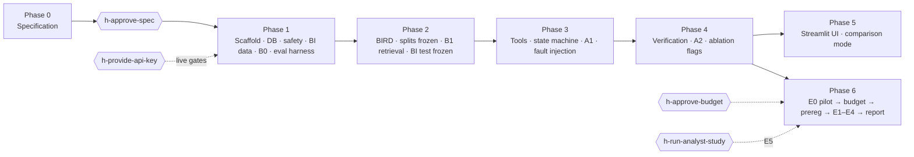

# Implementation Plan — Phases, Tasks, Gates

> **Status:** SPECIFIED (Phase 0). Spec version 0.1.0, 2026-11-23. Phase 0 (this specification) is the only phase with work done. Phases 1–6 are not started.

## 0. How this plan is executed (ai-native workflow)

This repository follows the operating contract in [`AGENTS.md`](../../AGENTS.md), adapted from [asapacsin/ai-native-engineering](https://github.com/asapacsin/ai-native-engineering):

- **Phase contracts.** Each phase has a JSON task contract in `docs/spec/contracts/phase-N.json`: goal, acceptance, boundaries, `approved_paths`/`forbidden_paths`, budgets, and **exact gate commands** (argv lists with timeouts and levels). The contracts are compatible with `ai_native.py validate`.
- **Independent requirement manifests.** `docs/spec/requirements/phase-N.json` maps each phase requirement to the gate ids and the minimum evidence level that prove it. Executors may not edit these files (`forbidden_paths`).
- **Work frontier.** `docs/spec/work.json` is the dependency-aware task registry in the ai-native frontier format. Human-only work (credentials, budget approval, the analyst study) has `HUMAN_*` owners and never blocks unrelated autonomous work. Capability-dependent tasks declare `requires` (`anthropic_api`, `network_bird`, `docker_postgres`).
- **Verdicts.** A task is `PASS` only with gate evidence bound to a commit, plus an independent review. Otherwise it is `REWORK`, `BLOCKED`, or `NOT_VERIFIED`. At most 3 attempts per task. Compile ≠ runtime; FakeLLM ≠ live model; replay ≠ fresh sample.
- **Spec gate.** `python3 scripts/check_spec.py` validates cross-document consistency, contract/requirement/frontier structure, canonical parameters, and that the frontier is executable in phase order. It runs in CI and in every phase contract.

The frontier is executable **sequentially**: every task depends only on tasks of the same or earlier phases (checked by `check_spec.py`). Phase 5 (UI) and Phase 6 (experiments) both depend only on Phase 4. They may therefore overlap, but the default order is 5 then 6.

## 1. Shared dependencies (pinned in `pyproject.toml` in Phase 1)

| Package | Use | Phase introduced |
| --- | --- | --- |
| Python ≥ 3.11 | runtime | 1 |
| `anthropic` (official SDK) | LLM adapter | 1 |
| `sqlalchemy` 2.x, `psycopg[binary]` 3.x | DB access | 1 |
| `sqlglot` | SQL parsing / validation / table extraction | 1 |
| `pydantic` 2.x, `pyyaml` | config + contracts | 1 |
| `numpy` | BI generator, stats | 1 |
| `scipy` | exact binomial (McNemar) | 1 |
| `pytest`, `ruff`, `import-linter` | tests, lint, import boundaries | 1 |
| `rank-bm25` | B1 retrieval | 2 |
| `streamlit`, `altair` | UI | 5 |
| Docker + `postgres:16` image | BI PostgreSQL | 1 |

No agent framework, vector database, or message queue.

## 2. Phase 0 — Specification (this change)

| | |
| --- | --- |
| Tasks | Write PRD, ARCHITECTURE, BASELINES, TOOLS, BENCHMARK, EXPERIMENTS, DATA_MODEL, IMPLEMENTATION_PLAN, RISKS, README; AGENTS.md; contracts; requirement manifests; frontier; parameters; `scripts/check_spec.py` + tests; CI; PR template |
| Gates | `spec-check` (static), `spec-tests` (unit); see `contracts/phase-0.json` |
| Acceptance | Gates pass; no contradiction found by `check_spec.py`; frontier executable in phase order |
| Definition of done | Committed and pushed to the working branch. The owner's approval of the spec (`h-approve-spec`) is recorded before Phase 1 starts. Independent model review: `NOT_RUN` (no reviewer CLI configured in this environment) |

## 3. Phase 1 — Repository, database environment, B0, evaluation harness

**Goal:** B0 runs end-to-end on BI-dev with a working, tested evaluation harness and deterministic safety.

### Tasks

| ID | Task | Depends on | Outputs |
| --- | --- | --- | --- |
| p1-scaffold | Package skeleton per [ARCHITECTURE.md](ARCHITECTURE.md) §2.1; `pyproject.toml` with pinned deps; ruff; pytest markers (`postgres`, `live`); import-linter contract (`systems` ↛ `eval`); `docker-compose.yml` (postgres:16 + init SQL creating `agent_ro`); CI jobs extended | h-approve-spec | runnable `python3 -m agent_sql --help`; CI green |
| p1-config | Pydantic config models; YAML loader → canonical JSON → `config_hash`; prompt registry (versioned files + SHA-256); `configs/` generated to match `docs/spec/parameters.json` | p1-scaffold | `configs/models.yaml`, `configs/pricing.yaml`, `configs/systems/*.yaml` |
| p1-llm | `LLMClient` protocol; `AnthropicClient` (explicit effort, adaptive thinking, strict tools, no sampling params, served-model capture, usage capture, SDK retry logging); `FakeLLM`; `CachedLLM` record/replay (fail on miss); pricing calculator | p1-config | `agent_sql/llm/*` |
| p1-tracing | Trace event schema; JSONL writer; credential redaction; manifest writer (git SHA, dirty check, hashes) | p1-config | `agent_sql/tracing/*` |
| p1-db | Engines (SQLite read-only URI + authorizer + progress handler; Postgres `agent_ro`); catalog (inspector + description loading); executor (read-only txn, rollback, timeout, `fetchmany`, result store) | p1-scaffold | `agent_sql/db/*` |
| p1-safety | Validator SR1–SR12 + warnings; policy (allowlists, restricted columns); adversarial corpus ≥ 40 reject / ≥ 20 pass; defense-without-validator integration test | p1-db | `agent_sql/safety/*`, `tests/safety_corpus/*.yaml` |
| p1-bi-data | `bi_dataset/schema.sql`; `generate.py` (seeded); `events/dev.json` (D1–D5); SQLite + Postgres loaders; `metrics.yaml` (definitions, formulas, required predicates, templates); invariant, determinism, planted-effect, and gold-sanity tests; `python3 -m bi_dataset.generate --check-determinism` mode (gate `bi-generator-determinism`) | p1-db | RetailCo-dev SQLite file + Postgres load; `data/manifests/bi_dev.json` |
| p1-bi-dev-tasks | 20 BI dev tasks covering all six types, each with gold SQL + `answer_spec`; engine-parity test | p1-bi-data | `bi_dataset/tasks/dev.jsonl` |
| p1-b0 | B0 pipeline; composer; prompts `b0/sql.v1.md`, `shared/composer.v1.md`; full-schema renderer; glossary renderer from `metrics.yaml` | p1-llm, p1-safety, p1-tracing, p1-bi-data | `agent_sql/systems/b0_oneshot.py`, `composer.py` |
| p1-eval-harness | Runner (shuffled interleaved schedule, workers, cost meter, `max_experiment_usd`); dataset adapter (BI); comparators (set-EX, answer_spec types); metrics M01–M12 (+ S01, S04–S06); post-hoc V-checks hook (stub returning N/A until Phase 4); stats (Wilson, bootstrap, exact McNemar, Holm); failure auto-coding; markdown/CSV report; CLI `run`, `score`, `report`; `tests/live/` (marker `live`) skeleton | p1-b0, p1-bi-dev-tasks | `agent_sql/eval/*` |
| p1-live-smoke | Live B0 run on 20 BI-dev tasks in record mode; commit the resulting cassette subset (≤ 5 tasks) as a replay fixture | p1-eval-harness, h-provide-api-key | `tests/replay/fixtures/b0_bi_dev/*`; dev-only report |

### Automated tests (minimum)

- Unit: config hashing stability; prompt registry versioning; pricing math; FakeLLM scripting; record/replay miss → error; validator rules (one test per rule); comparator cases (set semantics, tolerance, column mapping, top-k order, F1); stats against known values (Wilson, McNemar exact p, Holm); failure auto-coding from synthetic traces; answer contract (no claims on failure).
- Safety corpus: every case matches its expected outcome.
- Integration: SQLite read-only (write attempt fails at L4); Postgres `agent_ro` (write fails at L2, restricted column fails, timeout fires); executor truncation flag; BI generator determinism (byte-identical CSVs) and invariants; gold parity SQLite == Postgres; B0 end-to-end with FakeLLM on 3 tasks.
- Replay: B0 on fixture tasks reproduces recorded predictions exactly, excluding wall-clock fields and `run_id`.

### Acceptance criteria

1. All `phase-1.json` required gates pass on a clean checkout (Postgres via docker-compose or CI service).
2. B0 produces a valid `RunResult` and trace for every BI-dev task, live or replay; no B0 failure produces a numeric claim.
3. `agent-sql report` regenerates the dev report from raw outputs alone.
4. `check_spec.py` still passes; `configs/` equals `parameters.json`.

### Definition of done

Gates pass on the reviewed commit, evidence is recorded in the frontier, and independent review returns PASS. If there are no credentials, `p1-live-smoke` stays `BLOCKED_EXTERNAL` and Phase 1 is reported as **offline-complete, live NOT_VERIFIED**, not as done.

## 4. Phase 2 — BIRD integration, B1 schema retrieval, frozen splits

**Goal:** Standardized benchmarking works, test sets are frozen, and B1 exists.

| ID | Task | Depends on | Outputs |
| --- | --- | --- | --- |
| p2-bird-download | Download script for BIRD dev from the official source; verify counts (1,534 questions, 11 DBs); write SHA-256 manifest; load description CSVs; `scripts/verify_bird_manifest.py` (gate `bird-manifest`) | p1-eval-harness | `data/manifests/bird_dev.json`, verifier script |
| p2-bird-splits | `scripts/make_bird_splits.py` per [BENCHMARK.md](BENCHMARK.md) §3.1; freeze `data/splits/bird.json`; `--verify-frozen` mode (gate `bird-splits-frozen`) | p2-bird-download | frozen split + hash |
| p2-bird-parity | Comparator parity vs official BIRD evaluation script on ≥ 300 predictions (incl. deliberate mismatches) | p2-bird-download | parity test |
| p2-retrieval | Schema docs builder; BM25 index; value index; top-k + FK expansion; S03 retrieval-recall evaluation; leakage test | p2-bird-download | `agent_sql/retrieval/*` |
| p2-b1 | B1 system + prompt `b1/sql.v1.md` | p2-retrieval | `agent_sql/systems/b1_retrieval.py` |
| p2-bi-test-freeze | `events/test.json`; RetailCo-test generation; BI val (20), test (50), study (20) tasks with gold + answer_spec; freeze hashes in `data/manifests/bi_test.json`; runner refuses mismatched test manifests; `bi_dataset/verify_frozen.py` (gate `bi-test-frozen`) | p1-bi-dev-tasks | frozen BI test |
| p2-val-baselines | Live B0 and B1 on BIRD-val + BI-val (dev-time, 1 run), for calibration only | p2-b1, p2-bird-splits, p2-bi-test-freeze, h-provide-api-key | dev-only report |

**Automated tests:** split determinism (same seed → same split; db-disjointness; difficulty strata present); parity test (100% agreement); retrieval determinism; leakage test; B1 end-to-end with FakeLLM; frozen-manifest refusal test; test-access log written on any test-split run.

**Acceptance:** gates in `phase-2.json` pass; `data/splits/bird.json` and `bi_dataset/tasks/test.jsonl` frozen, with hashes committed **before any Phase 3 commit**; parity at 100%.

**Definition of done:** as in Phase 1. From this point, test files are in every later contract's `forbidden_paths`.

## 5. Phase 3 — A1 tool-based execution and recovery

**Goal:** A1 runs within budgets, recovers from failures, and is fully traced.

| ID | Task | Depends on | Outputs |
| --- | --- | --- | --- |
| p3-tools | Tool registry (strict JSON schemas, permissions, purpose field); 8 data tools per [TOOLS.md](TOOLS.md) §2; control tool `submit_answer`; error classes + deterministic hints | p2-b1 | `agent_sql/tools/*` |
| p3-orchestrator | State machine ([ARCHITECTURE.md](ARCHITECTURE.md) §4.2); budget guard; FINALIZE with reserve; failure counting; answer-contract check; terminal statuses | p3-tools | `agent_sql/orchestration/*` |
| p3-a1 | A1 system + prompt `a1/system.v1.md`; flags `schema_context`, `exploration_tools`, `execution_feedback`, `repair_budget` | p3-orchestrator | `agent_sql/systems/a1_agent.py` |
| p3-fault-injection | FM1 executor wrapper; `RetailCo-test-drift` and `-casing` variants (generated from frozen test seed, documented); E3 configs | p3-a1, p2-bi-test-freeze | `bi_dataset/variants/*`, `configs/experiments/e3_*.yaml` |
| p3-a1-val | Live A1 on val (1 run) for calibration; record budget-hit rates | p3-a1, h-provide-api-key | dev-only report |

**Automated tests:** tool schema validation (invalid args, disallowed tools); each data tool on SQLite + Postgres fixtures; state-machine property tests (random scripted FakeLLM sequences always terminate within budgets; the 4th failure always terminates; no `ANSWERED` without a successful `final_query_id`); FINALIZE path; each flag changes only its intended behavior; replay test for A1.

**Acceptance:** gates in `phase-3.json` pass; property test with ≥ 1,000 random action sequences shows 0 budget violations and 0 non-terminating runs.

## 6. Phase 4 — A2 planning, multi-step analysis, verification

**Goal:** A2 runs with plan, inspection, verification, and grounding. All ablation flags work.

| ID | Task | Depends on | Outputs |
| --- | --- | --- | --- |
| p4-verification | V1–V8 ([BASELINES.md](BASELINES.md) §A2); grounding checker; sqlglot metric-conformance matcher; reconciliation templates from `metrics.yaml`; post-hoc evaluator hook enabled for all systems (M11, S01) | p3-a1 | `agent_sql/verification/*` |
| p4-a2 | `submit_plan` / `complete_step`; PLAN_CHECK; step loop; INSPECT; VERIFY with verification-query budget; GROUNDING revision; uncertainty floor; prompts `a2/plan.v1.md`, `a2/system.v1.md` | p4-verification | `agent_sql/systems/a2_planner.py` |
| p4-ablations | Flags `planning`, `verification`; B1-SC pipeline; ablation configs AB1–AB9 | p4-a2 | `configs/experiments/e2_*.yaml` |
| p4-a2-val | Live A2 on val (1 run); calibrate B1-SC `n` (token-matched to A1 ±15%) | p4-ablations, h-provide-api-key | dev-only report; `n` recorded |

**Automated tests:** each V-check on crafted positive and negative fixtures (e.g. V2 catches missing `is_test_account` filter, V3 catches a breakdown that doesn't sum, V5 catches fan-out); PLAN_CHECK accept/reject cases; A2 state-machine property tests; grounding revision path; uncertainty-floor override; injection-string fixture shows no unsafe effect; replay test for A2.

**Acceptance:** gates in `phase-4.json` pass; every ablation config runs with FakeLLM end-to-end.

## 7. Phase 5 — BI interface and side-by-side comparison

**Goal:** Minimal Streamlit app per [PRD.md](PRD.md) §6.

| ID | Task | Depends on | Outputs |
| --- | --- | --- | --- |
| p5-ui | Ask, Compare (B0 vs A2 default; any two selectable; sequential, randomized order), and Trace pages; deterministic chart rules; validation and warnings panels; served-model display | p4-a2 | `agent_sql/ui/*` |

**Automated tests:** Streamlit `AppTest` with FakeLLM: Ask renders answer/tables/SQL/trace/validation; Compare renders both columns with latency/tokens/cost; Trace page loads a saved trace; chart-rule unit tests; no thinking content rendered (assert trace view uses only tool/observation/decision events).

**Acceptance:** gates in `phase-5.json` pass. A manual smoke check with a live key is recorded as evidence or marked `NOT_VERIFIED`.

## 8. Phase 6 — Full evaluation, ablations, failure analysis, technical report

| ID | Task | Depends on | Outputs |
| --- | --- | --- | --- |
| p6-pilot | E0 on val: measured cost/latency per system; budget-hit rates; B1-SC `n` confirmation | p4-a2-val | `reports/e0_pilot.md` |
| p6-preregister | `experiments/preregistration.md`: hypotheses, frozen config hashes, test manifest hashes, analysis plan; committed before E1; CLI `agent-sql prereg --verify` (gate `preregistration-locked`) checks that every test-split config hash is listed | p6-pilot, h-approve-budget | preregistration commit SHA |
| p6-main | E1: 4 systems × 200 × 3 | p6-preregister | `reports/e1_main.md` |
| p6-ablations | E2 per approved budget | p6-main | `reports/e2_ablations.md` |
| p6-robustness | E3 fault injection | p6-main, p3-fault-injection | `reports/e3_robustness.md` |
| p6-cross-engine | E4 (exploratory) | p6-main | `reports/e4_cross_engine.md` |
| p6-failure-analysis | E7: labeling guide; auto + hand codes; κ where two labelers; comparator audit (30 per system) | p6-main | `reports/e7_failures.md` |
| p6-report | Technical report: all hypotheses, ablation classifications, cost/latency, failures, limitations, NOT_VERIFIED list; CLI `agent-sql report --verify-reproducible --all` (gate `reports-reproducible`) | p6-ablations, p6-robustness, p6-failure-analysis | `reports/technical_report.md` |

Human tasks: `h-run-analyst-study` (E5), `h-judge-audit` (E6). The technical report includes their results if they exist; otherwise it lists them as not verified.

**Automated tests:** report regeneration from archived raw outputs reproduces committed reports byte-for-byte; preregistration hash check in the runner; cost meter stops at the cap (FakeLLM with synthetic usage).

**Acceptance:** gates in `phase-6.json` pass; every preregistered hypothesis is reported with effect size, CI, and Holm-adjusted p; every ablation is classified; failure codes cover 100% of B0 and A2 failed test tasks.

**Definition of done:** the technical report is committed, raw outputs are archived as a release asset, and the reproduction instructions are tested by re-scoring from the archive.

## 9. Sequential-execution check (done for this spec)

`scripts/check_spec.py` verifies that:

1. Every work item's dependencies exist and the graph is acyclic.
2. No task depends on a task from a later phase.
3. Every autonomous phase task has a `contract_path` pointing to an existing, valid contract.
4. Every requirement's `gate_ids` exist in that phase's contract.

A topological order of `docs/spec/work.json` therefore exists that follows Phase 0 → 6.
